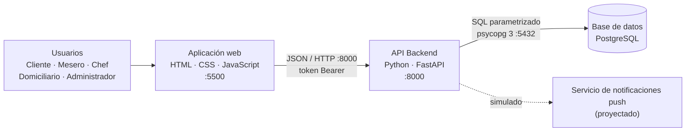

# La mesa de la abuela

Sistema de información para gestionar los pedidos de un restaurante, tanto en mesa como a domicilio, de principio a fin: el cliente o el mesero registra el pedido, el chef lo prepara, el sistema asigna al domiciliario, la entrega se cierra con el cobro y la venta queda visible para el administrador.

> **Entregable #3 · Diseño de Sistemas de Información · ITM**
> Docente: Alexandra Guerrero Bocanegra · Fecha de entrega: 19 de noviembre de 2026

## Tabla de contenido

1. [Descripción del proyecto](#1-descripción-del-proyecto)
2. [Integrantes del equipo](#2-integrantes-del-equipo)
3. [Tecnologías utilizadas](#3-tecnologías-utilizadas)
4. [Arquitectura general de la solución](#4-arquitectura-general-de-la-solución)
5. [Funcionalidades implementadas](#5-funcionalidades-implementadas)
6. [Requisitos de instalación](#6-requisitos-de-instalación)
7. [Configuración del entorno y dependencias](#7-configuración-del-entorno-y-dependencias)
8. [Ejecución del frontend y del backend](#8-ejecución-del-frontend-y-del-backend)
9. [Enlace al despliegue](#9-enlace-al-despliegue)
10. [Documentación técnica y diagramas](#10-documentación-técnica-y-diagramas)
11. [Evidencias del MVP](#11-evidencias-del-mvp)

---

## 1. Descripción del proyecto

**El problema.** Hoy el restaurante gestiona sus pedidos en papel y libretas: el pedido a domicilio se toma por llamada o mensaje y se anota a mano, y el pedido en mesa se escribe en una nota que viaja a cocina y luego a caja. Eso genera desorden, pérdida de información y falta de coordinación entre quienes participan.

**La solución.** Un MVP que construye **el recorrido completo de un pedido**, con sus reglas de negocio y sus flujos alternativos:

```
Cliente o mesero lo registra → el chef lo ve y lo toma → lo marca listo
→ el sistema asigna domiciliario y avisa → el domiciliario entrega y cobra
→ el pedido aparece en las ventas del administrador
```

**Roles del sistema:** Cliente, Mesero, Chef, Domiciliario y Administrador. Cada uno accede solo a las funciones de su rol.

**Alcance.** El MVP incluye pedidos en mesa, pedidos a domicilio y pago contra entrega. Lo que queda fuera se identifica como *proyectado* en los diagramas y no se programa (ver [sección 5](#5-funcionalidades-implementadas)).

## 2. Integrantes del equipo

Equipo 2 · Curso Diseño de Sistemas de Información · ITM

| Integrante | Usuario de GitHub |
|---|---|
| Sara Pabón González | SaraPabonGonzalez|
| Paulina Franco Barragan |Paulifb|
| Daniela Restrepo Cano | danikpop88 |
| Angie Vanessa Córdoba Estrella | vanesaCordoba07|

## 3. Tecnologías utilizadas

| Pieza | Tecnología | Para qué se usa |
|---|---|---|
| Lenguaje del backend | **Python 3.11+** | Lógica de negocio y API |
| Framework de la API | **FastAPI** + **uvicorn** | Rutas, validación de entradas con tipos y documentación automática en `/docs` |
| Base de datos | **PostgreSQL** | Persistencia (puerto 5432) |
| Acceso a datos | **psycopg 3** | Consultas SQL parametrizadas, sin ORM |
| Abstracciones | **`abc.ABC`** | Clases abstractas e interfaces del diagrama de clases |
| Seguridad | **`hashlib.scrypt`** (librería estándar) | Hash de contraseñas con sal por usuario |
| Pruebas | **pytest**, **pytest-cov**, **httpx** | Pruebas unitarias y de rutas; cobertura mayor al 70 % |
| Frontend | **HTML / CSS / JavaScript** | Vistas por rol; `fetch` para hablar con la API |
| Servidor del frontend | `python -m http.server` | Sirve los archivos estáticos (puerto 5500) |
| Diagramas | draw.io, PlantUML, C4 | Documentación de la arquitectura |
| Gestión del proyecto | Jira, GitHub, Spec Kit | Historias de usuario, control de versiones y especificación |

**Patrones de diseño (GoF):** State, Factory Method, Observer, Proxy y Command. Cada uno resuelve un problema real del MVP (ver [sección 4](#patrones-de-diseño)).

## 4. Arquitectura general de la solución

### Tres capas, tres contenedores



- La aplicación web **solo habla con la API**, a través de un único archivo (`cliente_api.js`). Nunca toca la base de datos.
- **Solo la API** se comunica con la base de datos y con los servicios externos.
- La API devuelve datos en JSON; no genera HTML.

### Un módulo por componente del C4

| Módulo (`backend/app/`) | Componente C4 | Patrón | Requisitos |
|---|---|---|---|
| `autenticacion/` | Autenticación de usuarios | — | RF-01, RF-06 |
| `menu/` | Menú y productos | — | RF-02, RF-12, RF-13, RF-14 |
| `pedidos/` (`estados/`, `creadores/`) | Pedidos | State · Factory Method | RF-03 a RF-06, RF-16 |
| `cocina/` | Cocina | Command | RF-18, RF-19, RF-20 |
| `domicilios/` | Domicilios | — | RF-21, RF-23, RF-24 |
| `ventas_pagos/` | Ventas y pagos | Proxy | RF-07, RF-10 |
| `notificaciones/` | Notificaciones | Observer | RF-17, RF-24 |
| `integraciones/` | Integraciones externas | — (simuladas) | RF-17, RF-24 |
| `reservas/` | Reservas (solo consulta) | — | RF-11 |
| `compartido/` | Apoyo: seguridad, conexión, reloj, excepciones | — | RNF-01, RNF-03 |
| `main.py` | Punto único de ensamblaje | — | — |

Los componentes **Inventario** y **Calificaciones** son proyectados y no se crean.

### Capas dentro de cada módulo

```
rutas.py                   CAPA DE RUTAS     recibe la petición, valida su forma, exige sesión y rol
   ↓
servicio.py + modelos.py   CAPA DE NEGOCIO   el "Gestor…" con las reglas de negocio (RN-01 a RN-10)
   ↓
repositorio.py             CAPA DE DATOS     contrato abstracto (ABC)
repositorio_postgres.py                      implementación con psycopg y SQL parametrizado
```

**Regla de dependencias:** ruta → servicio → contrato del repositorio. Solo `main.py` conoce las clases concretas.

### Patrones de diseño

| Patrón | Dónde | Qué resuelve |
|---|---|---|
| **State** | `pedidos/estados/` | El comportamiento del pedido cambia según su estado: `Recibido → EnCocina → EnCamino → Entregado` |
| **Factory Method** | `pedidos/creadores/` | Crea pedidos de mesa y de domicilio, que exigen datos distintos |
| **Observer** | `pedidos/` y `notificaciones/` | Avisa automáticamente al mesero o al domiciliario cuando el pedido está listo |
| **Proxy** | `ventas_pagos/` | `ServicioPagoProxy` valida y registra el cobro antes de delegar en `ServicioPagoReal` |
| **Command** | `cocina/` | Las acciones del chef (marcar listo, cancelar) son objetos con auditoría: quién y cuándo |

### Estructura del repositorio

```
.
├── README.md
├── .gitignore
├── db/
│   ├── crear_tablas.sql          # las 9 tablas del MVP
│   └── datos_ejemplo.sql         # menú, mesas, usuarios de prueba y reservas de ejemplo
├── frontend/                     # Aplicación web (puerto 5500)
│   ├── (vistas HTML/CSS por rol)
│   └── js/
│       ├── cliente_api.js        # única pieza que habla HTTP con el backend
│       ├── autenticacion.js
│       └── notificaciones.js
├── backend/                      # API Backend (puerto 8000)
│   ├── requirements.txt
│   ├── app/
│   │   ├── main.py · config.py
│   │   ├── compartido/
│   │   └── autenticacion/ pedidos/ cocina/ domicilios/ ventas_pagos/
│   │       menu/ reservas/ notificaciones/ integraciones/
│   └── pruebas/                  # pytest
└── speckit-Llenos/               # especificación del backend (Spec Kit)
```

> Las reglas que gobiernan el diseño están en la [constitución del proyecto](speckit-Llenos/1_constitution.md): la documentación manda, las reglas de negocio viven solo en el backend, y todo lo que no está en el C4 se marca como proyectado.

## 5. Funcionalidades implementadas

Cada requisito funcional tiene uno de tres estados en el MVP:

- ✅ **Implementado:** funciona de verdad.
- 🟠 **Simulado:** el comportamiento existe, pero el servicio externo real se reemplaza por una versión de prueba.
- ⬜ **Proyectado:** se documenta y se diseña, pero no se programa.

| RF | Qué permite | Rol | Estado |
|---|---|---|---|
| RF-01 | Registrarse e iniciar sesión según el rol (el administrador crea las cuentas del personal) | Todos | ✅ |
| RF-02 | Ver el menú por categorías | Cliente | ✅ |
| RF-03 | Armar el carrito y calcular el total | Cliente | ✅ |
| RF-04 | Ver el resumen del pedido | Cliente | ✅ |
| RF-05 | Ver el estado del pedido y cancelarlo mientras aún se pueda | Cliente | ✅ |
| RF-06 | Registrar la dirección de entrega | Cliente | ✅ |
| RF-07 | Elegir pago contra entrega | Cliente | 🟠 sin pasarela de pago |
| RF-08 | Reservar una mesa | Cliente | ⬜ |
| RF-09 | Calificar el servicio | Cliente | ⬜ |
| RF-10 | Ver ventas y pagos | Administrador | ✅ |
| RF-11 | Ver reservas vigentes | Administrador | ✅ con datos de ejemplo |
| RF-12 | Editar productos del menú | Administrador | ✅ |
| RF-13 | Crear productos nuevos | Administrador | ✅ |
| RF-14 | Marcar un producto como Agotado | Administrador | ✅ |
| RF-15 | Consultar inventario de cocina | Administrador | ⬜ |
| RF-16 | Tomar, ver, modificar y cancelar órdenes de mesa | Mesero | ✅ |
| RF-17 | Recibir aviso de plato listo | Mesero | 🟠 aviso en pantalla |
| RF-18 | Ver la cola de cocina (pedidos de mesa) | Chef | ✅ |
| RF-19 | Ver la cola de cocina (pedidos a domicilio) | Chef | ✅ |
| RF-20 | Avisar que una orden está lista | Chef | ✅ |
| RF-21 | Cerrar la entrega y registrar el cobro | Domiciliario | ✅ |
| RF-22 | Comunicarse con el cliente | Domiciliario | ⬜ |
| RF-23 | Consultar contacto y dirección del cliente | Domiciliario | ✅ |
| RF-24 | Recibir aviso de pedido listo; el sistema le asigna el pedido | Domiciliario | 🟠 aviso en pantalla |

### Reglas de negocio que el backend aplica

- **RN-01:** un pedido solo se puede modificar o cancelar durante los primeros 5 minutos.
- **RN-04:** un pedido que está en cocina no se modifica ni se cancela.
- **RN-05:** un producto agotado no se puede agregar al carrito ni pedir.
- **RN-07:** un pedido a domicilio exige el teléfono del cliente.
- **RN-08:** un pedido que ya está en camino no se reasigna a otro domiciliario.
- **RN-09:** solo el Administrador modifica el menú y crea cuentas del personal.
- **RN-10:** solo el Administrador ve los reportes de ventas y pagos.

Cada regla tiene su flujo alternativo implementado: cuando se viola, la API responde con un error controlado y un mensaje claro en español.

### Fuera del MVP (proyectado)

Pagos en línea con pasarela · ruta optimizada para domiciliarios · comunicación entre domiciliario y cliente · calificación del servicio · creación de reservas por el cliente · inventario de insumos · notificaciones push reales · HTTPS con TLS 1.3 · respaldos automáticos diarios.

## 6. Requisitos de instalación

| Herramienta | Versión | Para qué |
|---|---|---|
| **Python** | 3.11 o superior | Backend y servidor del frontend |
| **PostgreSQL** | Cualquier versión reciente, en el puerto 5432 | Base de datos |
| **Git** | Cualquier versión reciente | Clonar el repositorio |
| **Navegador** | Las dos últimas versiones de Chrome o Firefox | Usar la aplicación (RNF-12) |
| `psql` (opcional) | Viene con PostgreSQL | Cargar los scripts; si no lo tiene, use pgAdmin u otro cliente SQL |

El proyecto se ejecuta con comandos estándar en **Linux, macOS y Windows**, sin depender de contenedores (RNF-15).

**Puertos que deben estar libres:** `8000` (API), `5500` (frontend) y `5432` (PostgreSQL).

## 7. Configuración del entorno y dependencias

### 7.1 Clonar el repositorio

```bash
git clone https://github.com/danikpop88/FrontendRestaurante.git
cd FrontendRestaurante
```

### 7.2 Crear la base de datos

Reemplace `<usuario>` por su usuario de PostgreSQL.

```bash
# base de desarrollo
psql -U <usuario> -c "CREATE DATABASE mesa_abuela;"
psql -U <usuario> -d mesa_abuela -f db/crear_tablas.sql
psql -U <usuario> -d mesa_abuela -f db/datos_ejemplo.sql

# base para las pruebas automáticas
psql -U <usuario> -c "CREATE DATABASE mesa_abuela_test;"
psql -U <usuario> -d mesa_abuela_test -f db/crear_tablas.sql
psql -U <usuario> -d mesa_abuela_test -f db/datos_ejemplo.sql
```

**Verificación:** `psql -U <usuario> -d mesa_abuela -c "\dt"` debe listar **9 tablas** (`usuario`, `producto`, `pedido`, `detalle_pedido`, `domicilio`, `pago`, `mesa`, `reserva` y `aviso`), y `producto`, `mesa`, `reserva` y `usuario` deben traer datos de ejemplo.

### 7.3 Instalar las dependencias del backend

```bash
cd backend
python -m venv .venv

# Windows (PowerShell)
.\.venv\Scripts\Activate.ps1
# Linux / macOS
source .venv/bin/activate

pip install -r requirements.txt
```

Dependencias (`backend/requirements.txt`): `fastapi`, `uvicorn`, `psycopg[binary]`, `pytest`, `pytest-cov` y `httpx`.

### 7.4 Variables de entorno

El backend las lee en `app/config.py`.

| Variable | Valor típico | Qué es |
|---|---|---|
| `DB_HOST` | `localhost` | Servidor de PostgreSQL |
| `DB_PUERTO` | `5432` | Puerto de PostgreSQL |
| `DB_NOMBRE` | `mesa_abuela` | Base de datos de desarrollo |
| `DB_USUARIO` | `<usuario>` | Usuario de PostgreSQL |
| `DB_CLAVE` | `<clave>` | Clave de PostgreSQL |
| `ORIGEN_FRONT` | `http://localhost:5500` | Único origen que la API permite (CORS) |

```powershell
# Windows (PowerShell)
$env:DB_HOST = "localhost"
$env:DB_PUERTO = "5432"
$env:DB_NOMBRE = "mesa_abuela"
$env:DB_USUARIO = "<usuario>"
$env:DB_CLAVE = "<clave>"
$env:ORIGEN_FRONT = "http://localhost:5500"
```

```bash
# Linux / macOS
export DB_HOST=localhost DB_PUERTO=5432 DB_NOMBRE=mesa_abuela
export DB_USUARIO=<usuario> DB_CLAVE=<clave>
export ORIGEN_FRONT=http://localhost:5500
```

## 8. Ejecución del frontend y del backend

Se necesitan **dos terminales**, con PostgreSQL encendido.

**Terminal 1: backend (API)**

```bash
cd backend
# con el entorno virtual activado y las variables de entorno definidas
uvicorn app.main:app --port 8000
```

**Terminal 2: frontend**

```bash
cd frontend
python -m http.server 5500
```

| Qué | Dirección |
|---|---|
| **La aplicación** (empiece por aquí) | <http://localhost:5500> |
| La API | <http://localhost:8000> |
| Documentación de la API (Swagger, generada por FastAPI) | <http://localhost:8000/docs> |
| PostgreSQL | `localhost:5432` |

**Usuarios de prueba:** `db/datos_ejemplo.sql` carga un usuario por cada rol (Cliente, Mesero, Chef, Domiciliario y Administrador) para poder entrar con cada uno. Los correos y claves están en ese archivo.

### Ejecutar las pruebas

```bash
cd backend
pytest --cov=app                          # usa la base mesa_abuela_test
pytest --cov=app --cov-fail-under=70      # falla si la cobertura baja del 70 %
pytest pruebas -k state                   # un patrón por separado: state, factory, observer, proxy, comando
```

### Si algo falla

| Síntoma | Causa probable |
|---|---|
| `ModuleNotFoundError` al arrancar | El entorno virtual no está activado o falta `pip install -r requirements.txt` |
| Error de conexión o 500 en todas las rutas | PostgreSQL apagado o variables de entorno mal definidas |
| El navegador bloquea las llamadas (CORS) | `ORIGEN_FRONT` debe ser exactamente `http://localhost:5500` |
| `localhost:5500` muestra una lista de archivos o un 404 | El servidor del frontend se arrancó fuera de la carpeta `frontend/` |
| 401 en todas las rutas | Sesión expirada (30 minutos sin actividad): iniciar sesión de nuevo |
| La pantalla dice «El servicio no está disponible» | La API está caída o no responde en `http://localhost:8000` |

## 9. Enlace al despliegue

**No aplica.** El MVP se ejecuta en un único equipo (`localhost`), con los tres nodos del diagrama de despliegue en la misma máquina. El despliegue en un servidor, con HTTPS (TLS 1.3), disponibilidad del 98,5 % y respaldos automáticos, está **proyectado** y no forma parte del MVP.

## 10. Documentación técnica y diagramas

### Especificación del backend (Spec Kit)

| Documento | Contenido |
|---|---|
| [1_constitution.md](speckit-Llenos/1_constitution.md) | Principios innegociables del proyecto |
| [2_spec.md](speckit-Llenos/2_spec.md) | Qué debe hacer el sistema: alcance, requisitos y los 21 criterios de aceptación |
| [3_plan.md](speckit-Llenos/3_plan.md) | Stack, estructura de carpetas, capas y decisiones de diseño |
| [4_research.md](speckit-Llenos/4_research.md) | Decisiones y alternativas descartadas |
| [5_data_model.md](speckit-Llenos/5_data_model.md) | Tablas, relaciones y estados |
| [6_contracts.md](speckit-Llenos/6_contracts.md) | Endpoints y formatos exactos de entrada y salida |
| [7_quickstart.md](speckit-Llenos/7_quickstart.md) | Cómo levantar y validar el proyecto |
| [8_tasks.md](speckit-Llenos/8_tasks.md) | Orden de construcción por fases |

### Diagramas

Todos los diagramas son consistentes con el modelo C4 del Entregable 2.

| Diagrama | Enlace editable |
|---|---|
| Modelo C4, nivel 1 (contexto) | [ver diagrama](https://drive.google.com/file/d/196L_Od7CoNocQ849ADMNS7g95kgbxmiw/view?usp=drive_link) | |
| Modelo C4, nivel 2 (contenedores) | [Ver diagrama](https://drive.google.com/file/d/1DCxrwqSpgYcT86H3iTcTA8YPLFDpOuWP/view?usp=sharing) ||
| Modelo C4, nivel 3 (componentes) | [Ver diagrama]( https://drive.google.com/file/d/1KoSu3hf7ludnPLqZQH7sHhVgVUr6kC_h/view?usp=sharing ) ||
| Modelo C4, nivel 4 (clases) | [Ver diagrama]( https://drive.google.com/file/d/1-4JWOOlUoJNu1YXuGqCGzXCDJ8Q8NiI/view?usp=sharing ) |
| Diagrama de actividades (Gestión de pedidos) | [Ver diagrama](https://drive.google.com/file/d/1GypC1ImQXy1ILWzktuAJrdIR4sSWP9ty/view?usp=sharing) |
| Diagrama de actividades (Gestión de domicilios) | [Ver diagrama]( https://drive.google.com/file/d/1s4h30LjPc2ouJQgzjHIaNaQt7Nul72hJ/view?usp=sharing ) |
| Diagrama de actividades(Gestión de pagos) | Código PlantUML, sección «Diagrama de actividades» |
| Diagrama de actividades(administración de cocina ) | [Ver diagrama]( https://drive.google.com/file/d/1EmHkqzTTPOYjEKbkJBL3gKSPVKRJ5sx/view?usp=sharing ) |
| Máquina de estados |Código PlantUML en el Entregable 3, sección «Máquina de estados»|
| Diagrama de componentes | [Ver diagrama]( https://drive.google.com/file/d/1SiM4sw7RkpF_RK2GHAhHKms0oFZt2iwL/view?usp=sharing ) |
| Diagrama de despliegue  | [Ver diagrama](https://drive.google.com/file/d/19R14UidVvwAdNxDyatDmqnitnBoNz3u/view?usp=sharing  ) |
| Diagrama de secuencia: gestión de pedidos |[Ver diagrama](https://drive.google.com/file/d/1LRgDLZlz_ga5qkIJa9u0B_6N0kPZihC5/view?usp=sharing ) |
| Diagrama de secuencia: gestión de domicilios |[Ver diagrama](https://drive.google.com/file/d/1Pru5jD4ekIvK5xOH4A4Pz5JUvYC8I0aA/view?usp=sharing  ) |
| Diagrama de secuencia: gestión de pagos |Código PlantUML, sección «Gestión de pagos» |
| Diagrama de secuencia: gestión de cocina |[Ver diagrama](https://drive.google.com/file/d/1PAlXPkAQhc1cgmAeHfc__WKxbRVHfQKW/view?usp=sharing ) |
  

## 11. Evidencias del MVP
Las capturas de cada pantalla del MVP están en este documento:[Ver capturas](https://docs.google.com/document/d/19Lx-qeQxUOB-fd23FJ7ihpmsrZiTqF-3/edit?usp=sharing&ouid=109810464831418010377&rtpof=true&sd=true) 


